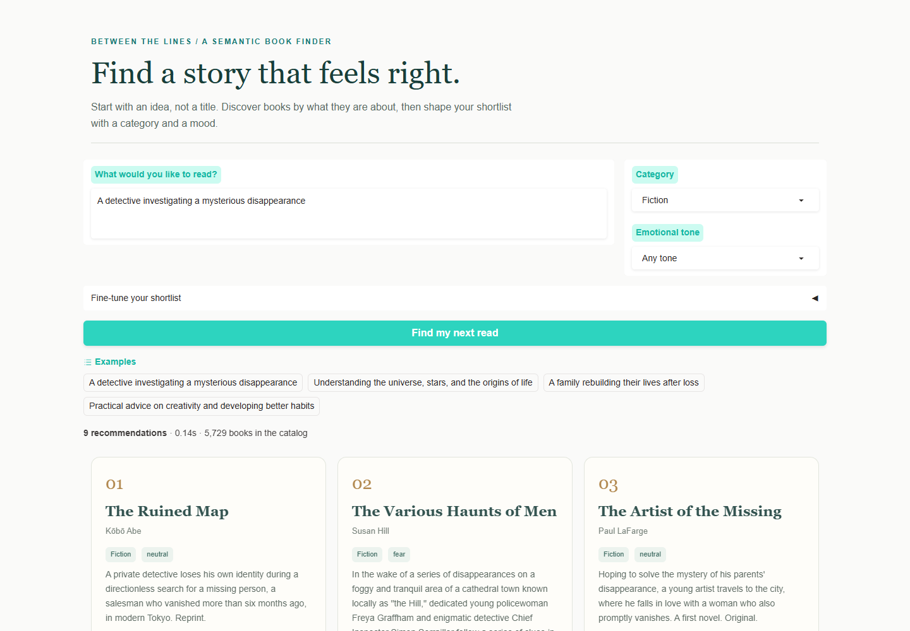
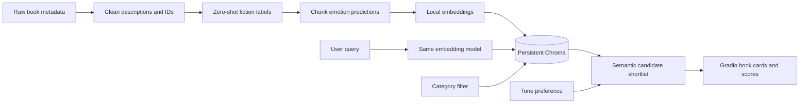

# Between the Lines

### A local LLM semantic book recommender

Find books from a description of what you want to read, filter fiction or non-fiction, and adjust the emotional tone. Built with **LangChain, Chroma, Hugging Face Transformers, and Gradio**.

Inspired by [Jodie Burchell's freeCodeCamp course](https://www.youtube.com/watch?v=Q7mS1VHm3Yw) and its [companion repository](https://github.com/t-redactyl/llm-semantic-book-recommender). This implementation keeps the five learning stages and replaces paid embeddings with local models. It is independently implemented, with attribution to the original tutorial.



## What it does

- Embeds book descriptions and natural-language queries with the same local transformer.
- Stores vectors and book IDs in a persistent Chroma database through LangChain.
- Predicts fiction/non-fiction with zero-shot natural language inference.
- Scores seven emotions in description chunks and averages them for each book.
- Presents ranked recommendations in a Gradio dashboard with category, tone, result-count, and mood-weight controls.
- Keeps preprocessing separate from serving; the dashboard loads only the embedding model.
- Includes explanatory notebooks, tests, a TF-IDF comparison tool, and documented evaluation results.

This is **content-based semantic retrieval**, not a chatbot, collaborative filtering system, or generative RAG application. It does not train a model from scratch or infer the reader's emotions.

## Free models

| Task | Local model | Reason for choosing it |
|---|---|---|
| Embeddings | `sentence-transformers/all-MiniLM-L6-v2` | Compact 384-dimensional embeddings suitable for CPU search |
| Fiction classifier | `MoritzLaurer/deberta-v3-base-zeroshot-v2.0` | Task-oriented NLI classifier; uses float32 for CPU inference |
| Emotion classifier | `j-hartmann/emotion-english-distilroberta-base` | Seven emotion labels; follows the tutorial's model choice |

These are practical laptop defaults, not a claim that one model is universally best. No API key, credit card, hosted inference, or paid subscription is needed. Initial package/model/data downloads need internet; inference uses your own CPU. Allow several GB of disk space for the environment and model cache. An 8 GB RAM machine is a reasonable starting target, not a benchmarked minimum; lower batch size if memory is tight. Full preprocessing may take a long time on CPU.

See [model selection notes](reports/model_selection.md) for the qualitative checks behind the classifier choice. DeBERTa runs explicitly in float32 because automatic float16 loading can be slow on CPUs.

## Quick start

Use **64-bit Python 3.11 or 3.12**. Run commands from this directory. Windows PowerShell commands below avoid activation-policy problems:

```powershell
python -m venv .venv
.\.venv\Scripts\python.exe -m pip install --upgrade pip
.\.venv\Scripts\python.exe -m pip install torch --index-url https://download.pytorch.org/whl/cpu
.\.venv\Scripts\python.exe -m pip install -r requirements.txt
.\.venv\Scripts\python.exe -m scripts.download_data
.\.venv\Scripts\python.exe -m scripts.build_pipeline --limit 200
.\.venv\Scripts\python.exe app.py
```

Open **http://127.0.0.1:7860**. Stop the app with Ctrl+C. On macOS/Linux, use `.venv/bin/python` instead. Select the `.venv` interpreter in VS Code to use the notebooks. See [validation results](reports/validation.md) for the tested configuration and catalog statistics.

After setup, Windows users can also double-click `run_dashboard.bat`. `requirements-lock.txt` records the tested environment; for an exact recreation, install it with the CPU wheel index available: `python -m pip install -r requirements-lock.txt --extra-index-url https://download.pytorch.org/whl/cpu`. The lock includes development tools as well as app dependencies.

After the first small run, build the complete catalog:

```powershell
.\.venv\Scripts\python.exe -m scripts.build_pipeline
```

The first command's `--limit 200` is **only a smoke-test catalog**, not the full dataset. Omitting the limit reuses cached predictions and adds the remaining books. Close the dashboard before rebuilding its data/index, then restart it. The cleaning report always describes the full input; the index manifest records the catalog actually indexed.

After models are cached, force offline loading with:

```powershell
$env:HF_HUB_OFFLINE = "1"
.\.venv\Scripts\python.exe app.py
```

The UI uses text cards and local styling, so book-cover servers are not needed. It binds to localhost and does not create a public Gradio share link.

## Project layout

```text
app.py                              Gradio dashboard
book_recommender/
  config.py                         Shared paths and model IDs
  data_exploration.py               Validation, cleaning, plots
  text_classification.py            Zero-shot fiction prediction
  sentiment_analysis.py            Seven-emotion scoring
  vector_search.py                  Embeddings, Chroma, ranking
  checkpoints.py                    Resumable model outputs
notebooks/
  01_data_exploration.ipynb
  02_text_classification.ipynb
  03_sentiment_analysis.ipynb
  04_vector_search.ipynb
  05_evaluation.ipynb
scripts/
  download_data.py                   Public dataset download
  build_pipeline.py                 Command-line orchestration
  evaluate.py                       Sanity checks and TF-IDF comparison
  create_notebooks.py               Rebuild explanatory notebook sources
data/raw/                           Downloaded books.csv (not committed)
data/processed/                     Cleaned, classified, enriched CSVs
data/evaluation_queries.json        Human relevance-label template
artifacts/chroma/                   Local persisted vectors (not committed)
artifacts/checkpoints/              Resumable prediction cache
reports/                            EDA, evaluation, validation results
tests/                              Unit and real Chroma integration tests
```

## Pipeline and design



**Cleaning.** Require a valid 13-digit identifier, a nonempty title, and at least 20 description words. Normalize whitespace and deduplicate ISBNs. Preserve source categories, missing author placeholders, and a record of removed rows. The 20-word threshold is a configurable heuristic; it may exclude useful concise blurbs.

**Classification.** Compare a title and description against the hypotheses “This book is Fiction” and “This book is Non-fiction”. The winning NLI label becomes a facet. Predictions below 0.65 confidence are flagged for review. That threshold is a review heuristic, not a calibrated accuracy guarantee. No source category is supplied as an input to the classifier.

**Emotions.** Split descriptions into sentence chunks, capped at 100 words; score anger, disgust, fear, joy, neutral, sadness, and surprise. Average chunk probabilities. The tokenizer still truncates at 512 tokens for unusually long words. This makes use of later sentences rather than scoring only the beginning of every blurb. Scores describe marketing text and can differ from the book's tone. A sentence heuristic can split abbreviations incorrectly.

**Embeddings.** One LangChain `Document` represents one book description; the ISBN and predicted category live in metadata. MiniLM truncates inputs above its configured token limit (normally 256 wordpieces). This simple baseline can miss themes near the end of long blurbs; chunked embedding with book-level aggregation is a future improvement. The emotion stage's chunking does not change embedding truncation.

**Retrieval.** Chroma uses cosine distance. Displayed similarity is `1 - distance`, not a probability. Category filtering happens within vector retrieval, before selecting candidates. Fetch up to `max(50, 4 * requested_count)` candidates, bounded by eligible catalog size. Resolve each hit by metadata ID in hit order.

**Mood reranking.** Let `s` be cosine similarity, `e` the selected emotion probability, and `w` mood influence:

```text
semantic_score = (clip(s, -1, 1) + 1) / 2
ranking_score = (1 - w) * semantic_score + w * e
```

With Any tone, the semantic score alone determines order. This weighted score combines two uncalibrated quantities and requires human evaluation; 0.25 is a chosen default, not an optimized weight. Suspenseful maps to fear and calm maps to neutral; both are imperfect proxies. Ties use similarity and then ISBN for deterministic results.

**Persistence.** Prediction cache keys include model ID, text, and settings. Index manifests include a CSV fingerprint and embedding model ID. A stale catalog fails with a rebuild instruction. Index builds use stable IDs and upserts; repeated runs do not duplicate books. Old index collections are retained, so rebuilding many versions increases disk use. For strict reproducibility, additionally pin Hugging Face model revisions; model IDs alone do not freeze upstream weights.

## Run stages separately

```powershell
.\.venv\Scripts\python.exe -m scripts.build_pipeline --stage clean
.\.venv\Scripts\python.exe -m scripts.build_pipeline --stage classify --limit 200
.\.venv\Scripts\python.exe -m scripts.build_pipeline --stage emotions
.\.venv\Scripts\python.exe -m scripts.build_pipeline --stage index
.\.venv\Scripts\python.exe -m pytest -q
.\.venv\Scripts\python.exe -m scripts.evaluate
```

Classification consumes the cleaned CSV; emotions consume the classified CSV; indexing consumes the enriched CSV. A standalone stage requires the previous stage's file. `--limit` affects classification only. Re-running all stages without `--limit` builds the full cleaned catalog. Checkpoints permit restart after interruption.

## Evaluation without invented claims

`scripts.evaluate` measures description self-retrieval and query latency. Self-retrieval only checks whether indexing/search can recover a book using its own description. It is **not recommendation accuracy**. Duplicate or nearly identical blurbs can lower even this score.

For quality evaluation, manually fill `data/evaluation_queries.json`, then run:

```powershell
.\.venv\Scripts\python.exe -m scripts.evaluate --judgments data/evaluation_queries.json
```

The evaluator compares semantic search with TF-IDF at k=5 using precision, recall, and binary nDCG. Incomplete judgments make recall unreliable; label a pooled candidate set consistently. Keep a held-out query set if tuning mood weights or thresholds. Category accuracy needs separately human-labelled fiction/non-fiction examples and a confusion matrix; the raw dataset categories are not necessarily gold labels. No relevance or classification accuracy is claimed until this work is done.

## Troubleshooting

| Symptom | What to do |
|---|---|
| `python` opens Microsoft Store | Install 64-bit Python 3.11/3.12 and reopen your terminal, or use a known interpreter path |
| Kaggle download fails | Download `books.csv` manually from the dataset page into `data/raw/` |
| Hugging Face download stalls | Check internet access; rerun to reuse cache; do not enable offline mode before downloading |
| High RAM use or slow CPU | Start with `--limit 200 --batch-size 4`; full enrichment is an offline preprocessing task |
| “Prepare the catalog first” | Run download and build commands before launching the dashboard |
| “Catalog changed since indexing” | Run `--stage index`, then restart the app |
| Port 7860 is occupied | Stop the earlier app with Ctrl+C, or set `GRADIO_SERVER_PORT` to another free port |
| Sparse category results | Try All; a tiny subset may contain few books of one type |
| Poor suggestions | Try a clearer English query, inspect the descriptions, and evaluate rather than assuming model correctness |

## Notebooks

The five numbered notebooks walk through data exploration, zero-shot classification, emotion analysis, vector search, and evaluation. They use the same modules as the command-line pipeline. See [validation results](reports/validation.md) for executed checks and measured results.

## References

- [Tutorial and code](https://github.com/t-redactyl/llm-semantic-book-recommender)
- [Dataset](https://www.kaggle.com/datasets/dylanjcastillo/7k-books-with-metadata)
- [MiniLM model card](https://huggingface.co/sentence-transformers/all-MiniLM-L6-v2)
- [DeBERTa zero-shot model card](https://huggingface.co/MoritzLaurer/deberta-v3-base-zeroshot-v2.0)
- [Jochen Hartmann's emotion model](https://huggingface.co/j-hartmann/emotion-english-distilroberta-base)
- [LangChain Chroma integration](https://docs.langchain.com/oss/python/integrations/vectorstores/chroma)
- [Gradio documentation](https://www.gradio.app/docs)
